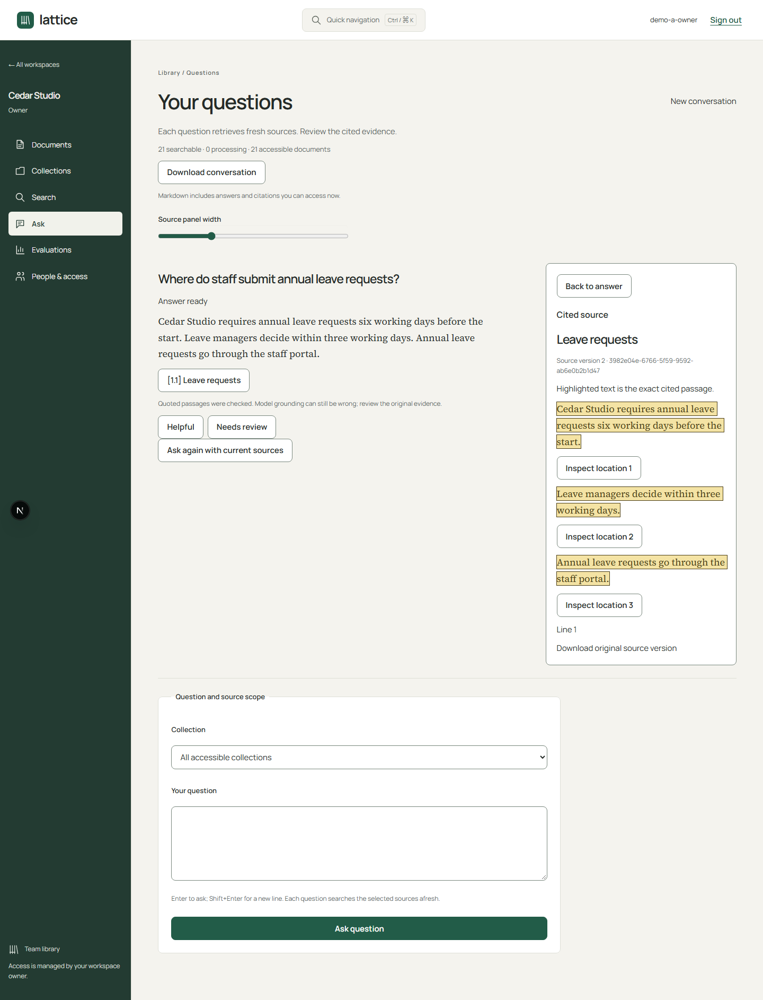

# Lattice

A private document workspace that answers questions with citations you can check.
Upload PDF, DOCX, TXT or Markdown files into access-controlled collections, search
them, and ask questions. Each answer quotes the exact passage it relies on, and the
reader highlights that passage in the original source version.

Everything runs locally: Django, PostgreSQL with pgvector, Celery workers, an
offline document parser, local E5 embeddings and a local Qwen model through Ollama.
All documents in this repository are synthetic.



*A real answer from the local Qwen model on the synthetic corpus, captured on
10 October 2026. The highlighted text is the exact passage each sentence cites.
A two-minute [walkthrough video](docs/assets/acceptance/walkthrough.webm) shows
upload, indexing and source inspection.*

## Try it

Needs Docker Desktop, Node 22+, pnpm 10, Python 3.12 and [uv](https://docs.astral.sh/uv/).

```sh
pnpm run setup && pnpm dev
```

Open http://localhost:4400, create an account, then a workspace and a collection,
and upload a file (there are 25 synthetic ones in `fixtures/corpus/r8-v1/`).
`setup` writes a gitignored `.env` with random local credentials. Mail such as
password recovery goes to a local Mailpit at http://localhost:8026.

Search needs an index, and every index needs the pinned E5 tokenizer and model
(about 470 MB from Hugging Face). Download it once into the Compose model volume,
then choose **Retry indexing** on each document:

```sh
docker compose run --rm --no-deps ingestion-worker python backend/manage.py prepare_models
```

The default mode is retrieval only: keyword search with source links. Cited answers
need `RAG_MODE=LOCAL`, a semantic index and a local Qwen model; see
[development](docs/DEVELOPMENT.md) and the [demo guide](docs/DEMO.md).

Last run from a fresh clone on 8 November 2026 (Windows 11, Docker Desktop): upload,
extraction, keyword indexing and search all worked.

## Tests and CI

| Suite | Size | Runs against |
| --- | --- | --- |
| Backend (pytest) | 655 tests in 40 files | Real PostgreSQL with pgvector, never SQLite |
| Web unit (Vitest) | 37 tests | jsdom |
| Browser (Playwright + axe) | 7 specs | Production web build, disposable API database, real parser container |
| Retrieval evaluation | 80 frozen cases over 24 synthetic documents | Offline E5 and PostgreSQL |

`pnpm verify` runs lint, formatting, types, Django checks, migration drift, the
tests and a production build. GitHub Actions runs it as **Verify**, plus a
dependency audit as **Security**.

**Both workflows pass on `main`** (run on 8 November 2026, commit `add4e71`).

## Engineering decisions

**Citations are checked against the source before an answer is shown.** The model
returns evidence IDs and quotes. `backend/pipeline/grounding.py` rejects any evidence
ID that was not retrieved, finds the quote in the stored chunk, and maps every cited
character back to a block and location in the source. An answer whose quote does not
map fully is refused, not shown. That mapping is what drives the highlight in the reader.

**Access is checked in the query, before pagination.** Collection and document reads
go through `readable_collections` and `readable_documents`, so restricted collections
never appear in a page, a count or a search result. Each workspace also has an access
epoch that deletion and index changes increment. A question records the epoch it was
asked under, and a change while it is being answered invalidates that answer.

**Deletion survives a database restore.** Deleting a document writes a tombstone to a
journal outside the database before the row changes (`modules/documents/lifecycle.py`).
If an older backup is restored, replaying the journal stops a deleted source from
coming back.

## Known limits

- **Answer quality is not proven.** In the recorded run, the small local model
  falsely abstained on 12 development and 8 held-out cases that had evidence, and it
  labelled all three held-out conflict cases as plain answers. Human review stands at
  0 of 80 cases. See [evaluation results](docs/EVAL-RESULTS.md).
- **Keyword search is literal.** It found 7 and 5 of 41 gold spans, against 41 of 41
  for semantic and hybrid search. A natural question such as "how much notice does
  leave require" can return nothing in keyword mode.
- **The first answer is slow.** One cold-start answer took 91 seconds, above the
  60-second target.
- **Local only.** No production deployment, HTTPS or cloud model adapters.

## Documentation

- [Development](docs/DEVELOPMENT.md): commands, host development, ports, test setup
- [Operations](docs/OPERATIONS.md) and [security boundaries](docs/SECURITY-BOUNDARIES.md)
- [Evaluation results](docs/EVAL-RESULTS.md) and the [acceptance workflow](docs/evaluations/ACCEPTANCE.md)
- [Case study](docs/CASE-STUDY.md), [interface design](docs/UI.md), [demo guide](docs/DEMO.md)
- [Specification](docs/BLUEPRINT.md) and [build log](docs/PROGRESS.md)

## License

No license has been chosen yet, so all rights are reserved.
