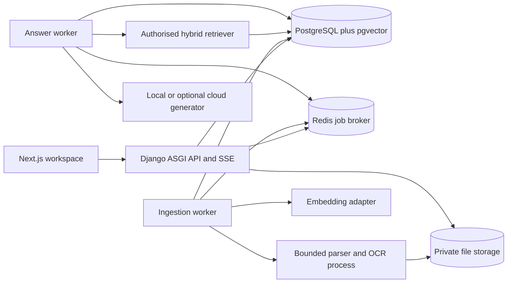

# Lattice — Cited Knowledge Workspace

> Project 9 of 9: a new independent retrieval-augmented generation system.
> Portfolio mapping: new RAG system; independent addition.
> Version 1.0 — 8 September 2026. Standalone implementation blueprint; no application or evaluation results exist yet.

## 1. Start here and product contract

Build **Lattice** in a separate repository at `<projects-root>/portfolio-recreations/rag-knowledge-workspace/`. Inspect the destination/instructions before creating or changing files. Copy this specification to the application's `docs/BLUEPRINT.md` and maintain `docs/PROGRESS.md`. Preserve the portfolio and every other project. This application must run independently of the Document Analysis or Robot Voice recreations.

Lattice lets a small team organise documents, search their contents, ask questions and inspect the exact evidence behind an answer. Its signature experience is a readable answer beside a source viewer that opens the cited document version and location. A user should understand what is indexed, what evidence was used, when content changed and when the system lacks an answer.

### Included in the first complete edition

- Accounts, workspaces, memberships, collections and explicit collection access.
- PDF, DOCX, TXT and Markdown uploads, plus manually authored Markdown notes as versioned documents.
- Asynchronous validation, extraction, basic OCR for scanned PDF pages, chunking and embedding; visible progress/retry/cancellation.
- Lexical and semantic search, hybrid ranking, collection filters and a retrieval inspector for maintainers.
- Cited question answering, conversation history, source inspection, feedback and export.
- Document replacement, staged reindex, versioned citations, immediate logical deletion and asynchronous physical purge.
- Local embedding and local generation profile; optional OpenAI profile; explicit retrieval-only and fixture modes.
- A reproducible evaluation corpus with answerable, unsupported, conflicting, multilingual and permission-sensitive questions.

Excluded: web crawling, live Google Drive/Slack connectors, agent tool execution, browser automation, scheduled external actions, arbitrary internet browsing, OCR correction/editor parity with Folio, spreadsheet ingestion, video/audio ingestion, enterprise SSO, public shared-chat links and fine-tuning. Keep generation read-only: retrieved text never authorises sending messages, running code or changing documents.

English UI with Unicode and Nepali source/question support; measure English and Nepali behavior separately. No promise of equal quality across languages. Seed fictional internal policies, product specifications, release notes and meeting summaries with no real organisational secrets. Success journey: upload -> inspect extracted content -> ready index -> ask -> verify citation -> replace source -> new answer uses new version -> remove access/delete source -> subsequent answers/history no longer expose restricted material.

## 2. Runtime architecture and provider decisions

Use Next.js, Django/DRF, PostgreSQL with pgvector, Celery/Redis and private file storage. PostgreSQL owns both metadata and retrieval records so access filters and document versions remain in the same queryable data model. Avoid a second vector database or an orchestration framework for the initial pipeline; small typed services make retrieval and evaluation inspectable.



| Layer | Selection |
|---|---|
| Frontend | Node 22.12+/pnpm 10, Next.js 16/React 19/TypeScript, Tailwind 4, Base UI, Lucide, RHF/Zod, TanStack Query |
| Backend | Python 3.12/uv, Django 5.2 LTS, DRF/drf-spectacular, ASGI server for SSE, Django sessions/CSRF |
| Data/jobs | PostgreSQL 17/pgvector 0.8 compatible patch, Redis 7/Celery and durable DB job records |
| Extraction | pdfplumber native PDF text/coordinates, pypdfium2 rendering, Tesseract 5 eng/nep, python-docx, safe Markdown/plain-text parser |
| Local embedding | `intfloat/multilingual-e5-small`, pinned model revision, Transformers/PyTorch inference, 384 dimensions |
| Local generation | Ollama local runtime with pinned `qwen3:4b` model digest, non-thinking answer mode where supported |
| Optional cloud | OpenAI Python SDK, text-embedding-3-small at 1536 dimensions, GPT-5.4 mini Responses API |
| Verification | pytest/PostgreSQL tests, numerical retrieval fixtures, Vitest, Playwright/axe, versioned eval runner |
| Local ops | Docker Compose/Caddy/Mailpit, filesystem adapter; optional S3-compatible storage |

Pin compatible patches and actual model digests during setup. The [multilingual E5 model card](https://huggingface.co/intfloat/multilingual-e5-small/raw/main/README.md) is the source for its model-specific embedding procedure: use literal `query: ` and `passage: ` prefixes, attention-mask-aware average pooling and normalised vectors. Respect the 512-token model input limit, including the prefix/title and special tokens. The project must test that implementation against a reference embedding. [Local Ollama structured output](https://docs.ollama.com/capabilities/structured-outputs) supports a JSON schema; schema support alone does not establish factual grounding. The [Qwen3 4B model entry](https://ollama.com/library/qwen3:4b) provides the downloadable model; capture its resolved digest and licence in the setup manifest.

For optional cloud mode, the [OpenAI embeddings guide](https://developers.openai.com/api/docs/guides/embeddings), [GPT-5.4 mini model page](https://developers.openai.com/api/docs/models/gpt-5.4-mini) and [structured output guide](https://developers.openai.com/api/docs/guides/structured-outputs) establish the selected API capabilities. Resolve an available supported snapshot at implementation time and record it; account availability is not guaranteed by this blueprint. No price claim is hardcoded. Provider keys remain server-side and are configured through environment, not stored as plaintext in a workspace settings table.

### Explicit operating modes

| Mode | What actually works | Required label/limits |
|---|---|---|
| `LOCAL` | Real local extraction, E5 embedding, hybrid retrieval, Ollama generation/citations | Default full implementation path after explicit model downloads |
| `CLOUD` | Same own retrieval pipeline, OpenAI embeddings/generation | Owner enables profile; upload screen explains document text is sent to configured provider |
| `RETRIEVAL_ONLY` | Extraction, lexical search and source viewing; local semantic search if installed | “Answer generation unavailable”; never invent a generated answer |
| `FIXTURE` | Deterministic known corpus response for interface/contract tests | Visible “Fixture response”; unknown questions have no fixture answer |

RETRIEVAL_ONLY may create an explicit lexical-only IndexVersion with embedding profile NONE; its readiness requires complete accepted extraction/chunking but no vectors. Switching to a semantic profile requires a shadow reindex before semantic search or generation can use that corpus. Configure the local generator with a tested context window of at least 16k tokens; cap total input at 10k tokens including system/history/evidence, and count with the model's tokenizer before dispatch. Reduce selected context with a visible scope note if it exceeds the budget; never rely on silent provider truncation.

No automatic fallback from LOCAL to CLOUD, or from a failed live call to a fixture answer. A profile switch is explicit. Embedding profile identity includes provider/model/dimension/tokenizer/preprocessing. Local and cloud vectors have separate dimension-constrained tables and are never compared. Generation profile can change without re-embedding only when the embedding profile stays identical. The full deliverable must demonstrate a real local or cloud generated answer and citation; fixture mode does not satisfy that gate.

Repository: `apps/web`, `backend/config`, `backend/modules/{identity,workspaces,collections,documents,ingestion,retrieval,conversations,providers,evaluations,audit}`, `backend/pipeline/{parsers,chunking,embedding,ranking,grounding}`, `contracts`, `fixtures/corpus`, `fixtures/evals`, `infra`, `tests`, `docs`. Typed contracts: `Extractor.extract`, `Chunker.chunk`, `Embedder.embedDocuments/embedQuery`, `Retriever.search`, `Generator.generate`, `GroundingValidator.validate`, `Storage.open/write/delete`. Interfaces carry version IDs, limits, cancellation and safe errors; they never accept arbitrary filesystem paths or browser-supplied provider URLs.

## 3. Data model and authorisation boundary

UUIDs, UTC timestamps, immutable source/processing versions and integer revision on mutable metadata. Workspace identifiers are derived from authenticated membership, not accepted as sufficient proof of access.

| Entity | Fields and invariant |
|---|---|
| User/Session/ActionToken | Active identity, expiring sessions/invites/recovery; hashed one-use action tokens |
| Workspace/Membership | Name, role OWNER/CURATOR/MEMBER/VIEWER, active flag, accessEpoch and quotas |
| Collection/CollectionGrant | Workspace, title, access WORKSPACE/RESTRICTED, granted membership IDs/read/write capabilities |
| Document | Workspace/collection, title, currentSourceVersionId, activeIndexVersionId, revision, deletedAt |
| SourceVersion | Immutable original/hash, MIME, bytes, language hint, created actor/time, extraction pointer |
| ExtractionVersion/Block | Parser/OCR version, text, source locator, warning state and content hash |
| IndexVersion | Source/extraction, chunker and embedding profile, state, chunk count and generation |
| Chunk | Workspace/collection/document/index IDs, text/hash, section, block spans, token count |
| Embedding384/Embedding1536 | Unique chunk/profile, finite vector of exact dimension; separate typed table per profile family |
| IngestionJob | Source/index/generation, phase, lease, retry/cancellation, safe error |
| Conversation/Turn | Workspace, owner, selected scope, immutable question, status, profile/corpus/access snapshot |
| RetrievalHit | Turn, ranked chunk/index IDs, lexical/vector/RRF scores, safe timing metadata |
| AnswerBlock/Citation | Turn/block, validated text; source/chunk IDs and exact evidence spans resolved server-side |
| Feedback | Author/turn, helpfulness, reason and optional private note; cannot alter answer history |
| EvalSuite/Case/Run | Corpus version, question/gold evidence, access persona, split and measured results |
| UsageReservation/UsageEvent | Workspace/job/provider, reserved upper bound, actual token counts, reconciliation status |
| JobEvent/AuditEvent | Durable sequence/request IDs, action metadata, no default raw prompt/document logging |

A workspace role sets a ceiling. OWNER manages members/configuration and all collections. CURATOR can upload/replace/manage documents in collections they can write. MEMBER can read accessible collections, ask questions and maintain their own conversations. VIEWER can read accessible documents/search and their own existing read-only report views, but cannot generate new answers or upload. Collection grants narrow access; they do not elevate VIEWER to CURATOR. Only OWNER changes grants or restricted collection visibility. A restricted collection with no grants is owner-only.

Collections are the access unit; every document belongs to exactly one collection. Moving a document is a permission change, not a metadata-only update: owner locks it, verifies destination in same workspace, increments accessEpoch and invalidates affected conversation/retrieval caches. No cross-workspace moves; use an explicit new upload if needed. Owner transfers ownership before removing the last active owner. Changing a membership/grant updates accessEpoch in the same transaction.

Every document/chunk query filters workspace, active membership, collection readability, `deletedAt IS NULL` and the eligible index version **before ranking/limit**. Do not retrieve global top-k and filter afterward. Vector and lexical paths, reranking, previews, exports, counts and download URLs use the same scope resolver. Database composite foreign keys or explicit constrained services prevent child rows linking resources across workspaces. Tests use deliberately colliding titles/hashes in two workspaces.

Conversations belong to their creator; workspace owner does not automatically get a private chat-reading endpoint. Chat sharing is out of scope. Every history read/export rechecks the caller's current membership and every cited source. If any supporting source is deleted or newly inaccessible, withhold the whole affected answer and its source excerpts; display “This answer uses sources that are no longer available.” Hiding only the citation link would leave the answer text exposed. Exclude withheld assistant answers from future model context. Prior user-authored questions remain the owner's own content; do not treat an old assistant answer as new user evidence.

Files are always privately stored. Same-origin permission-checked routes stream originals/previews; avoid long-lived signed URLs that survive revocation. No shared CDN caching of document contents, chats or source previews. Cookie HttpOnly/Secure in HTTPS/SameSite Lax, CSRF and Origin validation for mutations, exact CORS origin, generic login/recovery errors and throttles. Fixture public demonstrations use an isolated read-only synthetic workspace, not a bypass around ordinary tenant checks.

## 4. Ingestion, versions and recovery

### Bounded pipeline

1. Authorised upload creates Document/SourceVersion and immutable private original plus ingestion job. Limit 25 MiB/file, 100 PDF pages, 500 documents/2 GiB source storage per workspace initially. Verify signature, MIME and decoding; DOCX ZIP expands to <=100 MiB/10,000 entries with no traversal/external relationship resolution. Reject password-protected PDFs, executable/HTML masquerades and unsupported types with clear errors.
2. Parser runs without network, provider keys or broad host mounts. Limit two CPU cores, 1 GiB RAM, 30 s per page and 5min per file. Native PDF text is preferred; pages with little usable text enter OCR based on versioned heuristic. Render max 150 DPI within pixel budget; Tesseract eng/nep can be selected per document. Record OCR warning/confidence, not a claim of perfect reading order.
3. Convert to canonical blocks preserving heading/paragraph/table boundaries. PDF locator is physical page index plus normalised bounding boxes; DOCX uses heading path/paragraph or table-cell anchor, never invented PDF-like page numbers. TXT/MD uses original line spans. Store original text, canonical text and span mapping so normalisation cannot shift citations silently. Sanitize Markdown at rendering, disallow raw HTML/remote embeds.
4. Create chunks by heading/paragraph/table boundaries: target 320 tokens, hard cap 384 tokens under the selected embedding tokenizer, overlap 40 tokens only within a section. Prefix/title plus chunk must fit the model's supported limit; count rather than truncate silently. Split long tables by row groups with repeated headers and correct cell provenance. Do not merge unrelated documents or pages without retaining every locator.
5. Embed in bounded batches (default 32 chunks) with immutable profile. Validate dimensions/finite values and store text hash. Partial batches can resume by chunk/profile/hash. Document READY requires complete extraction, accepted warning policy and every required chunk/vector; a job failure cannot leave a partially searchable new version.
6. In one transaction verify job generation, document not deleted, unchanged desired source/profile and access context; atomically activate the new IndexVersion and source pointer. Old indexed version remains searchable while replacement processes. UI distinguishes “Current searchable version” from “Replacement processing”. New queries see one active version per document, never mixed old/new chunks.

For a PDF containing a failed/unsupported page, mark `NEEDS_REVIEW` and keep its index inactive. CURATOR can explicitly accept partial extraction with a page exclusion list and reason; source detail and answer citations then show “Partial document indexed”. No automatic whole-document-ready claim for silently skipped pages. OCR correction beyond re-run/language/partial acceptance belongs to a future edition; keep scope smaller than the separate Document Analysis project.

### State, retries and deletion

Index/job states: `QUEUED -> VALIDATING -> EXTRACTING -> CHUNKING -> EMBEDDING -> READY`, with `NEEDS_REVIEW`, `FAILED`, `CANCEL_REQUESTED`, `CANCELLED` and `SUPERSEDED` branches. Progress reflects committed pages/chunks; phase is more reliable than a made-up total percentage. A newer replacement supersedes an older pending replacement using desiredVersion/generation, so a late worker cannot reactivate obsolete content.

Celery is at least once; DB job leases own publication. Heartbeat 15 s/lease 90 s; reconciler requeues eligible expired jobs. Parser child termination targets its owned process only. Retry transient provider429/5xx with bounded exponential backoff/jitter, max 3 attempts per batch and overall job deadline. Invalid file/schema errors are terminal until a new source or corrected setting exists. Redis loss is recoverable from queued DB records; duplicate messages do not duplicate versions/vectors.

Delete immediately tombstones Document, clears active search pointer and increments accessEpoch; later reads/search/history enforce that state. Cancel jobs; purge originals, previews, extracted text, chunks/vectors and affected stored answer bodies asynchronously, default within 24h. A deleted source's historical answer becomes an unavailable marker immediately, even before physical purge. Minimal audit IDs/counts can remain without text. A backup may retain deleted content until its configured retention expires; operations docs must state that interval and reapply tombstones on restore. Never promise instantaneous erasure from already downloaded files or backups.

Nondeleted old versions remain for prior citation inspection until explicit owner retention cleanup. New queries use active versions, but existing answers resolve exact old versions while still authorised and retained. Purging an old version marks dependent answers unavailable before removing bytes. Embedding profile migration creates shadow indexes for all selected documents; switch workspace profile only when every eligible active source is ready in that profile. Keep previous profile until rollback window ends. Failed reindex leaves the working profile intact.

## 5. Retrieval and grounded answer protocol

### Deterministic retriever baseline

Normalise Unicode, preserve meaningful identifiers/numbers, cap question at 4,000 characters and use safe query construction. Primary retrieval query is the current user question. Follow-ups may include at most the two most recent authorised user questions; no unconstrained LLM query rewrite in edition one. Scope is current selected collections, intersected with current access; no silently broadened search when a selected collection yields no evidence.

Run lexical and vector ranking over the same authorised active corpus. Lexical uses PostgreSQL `tsvector` with English configuration for English and simple configuration for Nepali/mixed text, weighted title/heading/body and `websearch_to_tsquery`; this is lexical search, not a claim of BM25. Vector uses normalised query embedding with its exact profile and cosine distance. Start with exact vector search at portfolio scale to establish correctness. [pgvector](https://github.com/pgvector/pgvector) supports exact/approximate search; [PostgreSQL text search](https://www.postgresql.org/docs/17/textsearch-controls.html) provides lexical parsing/ranking. ANN/HNSW is a later measured optimisation requiring filtered recall tests, not an automatic scaling badge.

Take top 20 per path, stable chunk-ID tie-breaker, deduplicate by chunk ID and fuse using equal-weight reciprocal rank fusion: `sum(1/(60+rank))`, ranks starting1. RRF is not a probability. Keep top 12, remove nearly identical overlapping text from the same source and choose up to 8 evidence chunks with at most3 per document unless fewer documents are available. Fit evidence to a6,000-token generation budget using that generator's tokenizer; preserve source headers and never truncate mid-citation. No learned reranker initially; evaluate the baseline before adding another model.

Store retrieval hit IDs/ranks, profile/index/corpus hashes, scope and timing. “Show retrieval details” is CURATOR/OWNER only and displays safe scores/excerpts from their current readable corpus. Model-generated confidence is not used as an access rule or proof of correctness. Optional relevance cutoffs are calibrated per embedding profile on the development suite; never apply one universal cosine threshold across local/cloud models. With no eligible evidence, return a deterministic insufficient-evidence answer without calling the generator.

### Answer schema and citations

Create a turn-scoped evidence registry assigning IDs `S1`...`S8` to authorised chunks. Send system instructions, current question, bounded authorised context and evidence records. Retrieved documents are untrusted data; instructions inside them cannot override the question, reveal system prompts, fetch URLs or call tools. No tools or external browsing are provided to the generator.

Require structured output with `status` (`ANSWERED`, `INSUFFICIENT_EVIDENCE`, `CONFLICTING_EVIDENCE`) and a bounded list of answer blocks. Each factual block contains plain text and one or more evidence references with an exact quote from the supplied canonical chunk. Maximum6 blocks/1,500 answer words; unsupported requests receive a concise explanation and suggested narrower question. Conflicting sources must be attributed separately; recency alone is not authority unless the document metadata explicitly marks a replacement/version relationship.

Example internal model output:

```json
{
  "status": "ANSWERED",
  "blocks": [
    {
      "text": "The fictional policy requires requests at least five working days ahead.",
      "evidence": [
        {"sourceId": "S2", "quote": "Submit requests at least five working days before the planned start."}
      ]
    }
  ]
}
```

Server validation checks schema/length, registry membership, exact normalised quote containment and offset mapping, current authorisation and source availability. Citation titles, URLs, version labels, page numbers and highlight rectangles are generated from stored source metadata, never trusted from model output. Quote validation establishes that a passage exists; it does not prove the answer entails it. Run a bounded grounding pass over each block and its quoted passages with the configured model, asking for supported/unsupported/uncertain plus evidence IDs; do not expose hidden reasoning. Reject unsupported/uncertain blocks and require the remaining answer to be coherent; otherwise abstain. This verifier is fallible and must be measured against human-labelled cases.

One repair attempt is permitted for malformed output/invalid evidence with the same authorised context; cap tokens/time and record it. A grounding failure produces `INSUFFICIENT_EVIDENCE` plus valid source suggestions rather than silently stripping a citation while keeping the claim. Provider refusal, timeout and budget exhaustion are distinct from insufficient document evidence. Formatting/citation validation never justifies an “always accurate” claim.

The response includes source-version IDs and evidence locations; citation click opens the exact retained version with the quoted span highlighted. The UI shows “An updated version exists” when appropriate. PDF page label uses physical page plus embedded label only when verified; DOCX uses section/paragraph. No invented page numbers for reflowable sources. Markdown exports include permission-checked citations and source version metadata; exporting is a new authorised operation, not a public static URL.

### Streaming, cancellation and permission races

Use durable turn jobs and SSE for honest progress: `accepted`, `retrieving`, `generating`, `validating`, then validated `answer` and terminal `completed`, or `failed/cancelled/access_changed`. Each event carries turnId, increasing sequence and safe timestamp. Raw provider token deltas are buffered privately until structured output and citations validate; the first edition streams progress and commits the validated answer together. Do not animate fake token typing or describe the unvalidated stream as a verified answer. The [OpenAI streaming guide](https://developers.openai.com/api/docs/guides/streaming-responses) covers provider events; the public event contract here is deliberately application-owned.

POST creates a turn and returns202; authenticated GET SSE attaches without creating another generation. Persist safe event sequence; Last-Event-ID reconnect resumes events, while a status GET is authoritative after event retention expires. Stop records cancellation and aborts provider work where supported; already-incurred provider usage remains recorded. One active turn per conversation; duplicate submission uses actor/conversation/idempotency key and returns the same turn, changed payload409. Regenerate creates an explicit new turn linked to the old one with a fresh retrieval snapshot.

At retrieval start record accessEpoch and selected index IDs. Recheck access before sending excerpts to a provider, before answer commit, and immediately before delivering/replaying answer or source events. Lock the relevant access-version row briefly to order the final database authorisation/commit against concurrent revocation; never hold a DB transaction through an AI call. If access/source state changes, cancel or rerun retrieval once before generation; after generation begins, discard that result and emit `access_changed`. Do not replay restricted answer events merely because they were authorised when stored. Information already delivered cannot be recalled; revocation denies new reads and subsequent delivery after the server observes the changed state.

## 6. API, quotas and operational security

Prefix `/api/v1`, generated OpenAPI TypeScript client, standard error `{error:{code,message,fieldErrors?,requestId}}`. 400 invalid input, 401 unauthenticated, 403 forbidden operation, 404 unavailable cross-workspace resource, 409 revision/state conflict, 413 size, 429 quota, 503 provider unavailable. Lists default 20/max 100 with stable cursor ordering. Enforce body limits before parsing; no raw provider exceptions or internal file paths in responses.

| Endpoint | Contract |
|---|---|
| GET/POST `/workspaces` | Member list/create with bootstrap owner rules |
| GET/PATCH `/workspaces/:id`, `/memberships/:id` | Current membership; owner-only role/config changes with expectedRevision |
| GET/POST `/workspaces/:id/collections` | Accessible collections; curator create within permitted scope |
| PATCH `/collections/:id/grants` | Owner, audited accessEpoch update |
| GET/POST `/collections/:id/documents` | Authorised list/upload; streaming multipart, 202 job |
| POST `/documents/:id/versions` | Replacement; expectedRevision/idempotency and source limits |
| GET/PATCH/DELETE `/documents/:id` | Current metadata/rename/tombstone; write permission checked |
| GET `/documents/:id/versions/:versionId` | Exact authorised retained version and processing warnings |
| GET `/documents/:id/versions/:versionId/preview` | Private bounded source content/locators; no unrestricted storage key |
| POST `/ingestion-jobs/:id/retry`, `/:id/cancel`, `/:id/accept-partial` | Defined job transitions, partial acceptance reason required |
| POST `/workspaces/:id/search` | Query, collection IDs, lexical/hybrid mode; only authorised hits |
| POST/GET `/workspaces/:id/conversations` | Create/list own conversations |
| POST `/conversations/:id/turns` | Question, selected collection IDs;202 turn ID and SSE path |
| GET `/turns/:id`, `/:id/events` | Authorised current status/history and safe SSE replay |
| POST `/turns/:id/cancel`, `/:id/feedback` | Owner of conversation, idempotent cancellation/feedback |
| GET `/turns/:id/citations/:citationId` | Rechecked source and exact locator; unavailable marker after deletion |
| POST `/conversations/:id/export` | Revalidate every answer/source; prepare private Markdown export |
| POST `/workspaces/:id/reindex` | Owner selects configured profile; shadow build and atomic activation |
| POST/GET `/workspaces/:id/evaluations` | Owner/curator with access to suite corpus; versioned measured run |
| GET `/health/live`, `/health/ready` | Liveness and DB/queue/storage/model readiness detail safe for exposure |

Question contract example:

```json
{
  "question": "How early should a team member submit a leave request?",
  "collectionIds": ["collection-demo-policies"],
  "answerStyle": "concise"
}
```

Application IDs are UUIDs; illustrative IDs are not executable seed assumptions. The browser cannot choose arbitrary models/provider base URLs, bypass the corpus scope or set maximum tokens above server limits. Configure provider origins on the server allowlist. Documents mentioning URLs do not cause network requests. Egress is allowed only in the embedding/generation adapter process for the configured provider; parser and storage workers have none.

Default quotas:10 question intents/minute/user, 2 active generation jobs/workspace, 1 active turn/conversation, 100 full answers/day/workspace and 500k embedding input tokens/day/workspace. Owner can set lower limits. Maximum per-answer budget: bounded6k-token evidence plus question/history/system overhead, 3k output tokens for draft generation and separately bounded verifier/repair budgets; actual total reservation is computed before accepting the job. Reserve quota atomically so concurrent jobs cannot all pass a stale remaining balance. Reconcile actual usage on completion; ambiguous provider outcomes retain an estimated reservation until reconciled rather than pretending zero cost. Monetary estimates use an operator-maintained dated price configuration and are labelled estimates.

Cloud mode sends extracted text for embeddings and selected excerpts/questions for generation; owner configuration makes this visible before use. Local mode performs these steps locally after model acquisition. In either mode log only IDs, duration, counts, model/profile and safe errors by default. Store sensitive prompt/evidence only as authorised application records with retention; do not duplicate them into general logs/traces. Set provider storage controls where supported but do not equate a request setting with guaranteed zero provider retention.

Use CSP, safe Markdown rendering, no remote image embeds, upload inspection and dependency pinning. Auth recovery uses local Mailpit by default; no automatic real invitation mail from demo seeding. Retry logic must not send emails or invoke external tools on the basis of generated answers. The knowledge assistant has no write-action capability.

## 7. Distinct professional UI/UX system

### Direction: quiet reading room

Parchment canvas, white reading surfaces, forest green actions and restrained amber evidence highlights. The signature is a three-part reading composition: collections/history at left, a carefully typeset answer in the middle, and the cited source at right. Prioritise question, scope and evidence over decorative metrics or a generic “AI dashboard”.

| Token | Specification |
|---|---|
| Canvas / surface | `#F3F1E9` / `#FFFFFF` |
| Ink / muted | `#22342B` / `#5B685F` |
| Primary / label | `#255D43` / `#FFFFFF` |
| Evidence highlight / ink | `#F4E3A4` / `#493C14` |
| Border / control border | `#D7DDD4` / `#7A887E` |
| Error / warning | `#A83C35` / `#805B22`, with text/icon |
| Focus | 3 px `#255D43` with 2 px white separation |
| UI typography | Manrope; headings28/1.25, labels14/1.4, interface body15/1.55 |
| Reading typography | Source Serif 4 answer text18/1.7, max 68ch; Noto Sans Devanagari fallback |
| Numeric metadata | Tabular Manrope; version IDs use system monospace12/1.4 |
| Shape/space | Radius8 panels/6 controls, 4/8/12/16/24/32/48 spacing |
| Motion | 120 ms buttons, 180 ms inspector opening; no perpetual glow or simulated typing |

Desktop >=1440 px: left rail248 px, answer flexible minimum560 px, source inspector440 px, header64 px. Between1100–1439 px use rail216 px and inspector360 px with a resizable answer/source split, clamp minimum widths and persist the user preference per device. Below1100 px inspector becomes a separate Source tab with a “Back to answer” link restoring the cited block focus; below768 px rail is an accessible drawer. No squeezed three-column layout on a phone. At360 px composer and citation buttons wrap without horizontal page scrolling.

Workspace first screen includes selected collection scope, question composer and recent conversations, with a concise status row showing ready/processing documents. Empty state has “Add documents” for curators or “Choose a collection” for members; do not present the same admin action to every role. Composer labels scope explicitly, supports Shift+Enter newline, Enter send when composition is complete, accessible submit button and Stop during active turn. IME composition must not submit Nepali text accidentally.

Answer blocks use numbered citation buttons immediately after supported claims. Hover can preview a short excerpt, but click/keyboard opens the full source with title, version, locator and exact highlight. Highlight colour supplements a labelled outline. A citation to a prior retained version shows an “Older version” chip. No source becomes a generic external browser tab when an in-app inspector can show evidence clearly. The answer status distinguishes supported response, conflicting sources, insufficient evidence, model unavailable and cancelled work.

Documents view is a table/list of title, type, collection, current searchable version, processing state, updated time and action. Replacement progress appears within the same document row; do not show two indistinguishable documents. Detail includes source preview, extraction warnings, versions and indexing activity. Upload queue shows per-file limits, phase, failed reason and precise retry options. Deletion confirmation names the document and explains that affected answers will become unavailable; avoid repeated confirmations for reversible metadata edits.

Evaluation view uses a comparison table, not a trophy score: suite/profile/corpus version, retrieval recall, citation validity, supported-claim rate, abstention, latency and token usage. Selecting a failure opens expected evidence, retrieved evidence and actual answer side by side. Numeric definitions are available near the metric; no green “100% trustworthy” badge. Member-facing answer view does not expose irrelevant token/embedding implementation details; those belong in maintainer diagnostics.

Routes: `/w/:workspaceId/ask`, `/w/:workspaceId/search`, `/w/:workspaceId/documents`, `/w/:workspaceId/documents/:id`, `/w/:workspaceId/c/:conversationId`, `/w/:workspaceId/collections/:id`, `/w/:workspaceId/evaluations`, `/w/:workspaceId/evaluations/:id`, `/w/:workspaceId/settings/members`, `/w/:workspaceId/settings/providers`. Every route needs loading/empty/failure/permission-expired/retry states. Preserve draft question and current selection after network errors; never submit it twice on reconnect.

Target WCAG 2.2 AA: normal text >=4.5:1, large text/control contrast >=3:1, visible focus, 44 px intended touch targets, labelled landmarks, keyboard-operable sources, readable language fallbacks and 200% zoom. SSE updates use polite live-region summaries at phase changes; avoid announcing every token or stealing focus when an answer arrives. Dialog focus returns to the invoking action. Source viewer supplies extracted text alongside page images for assistive access; chart/table content has textual alternatives.

## 8. Evaluation corpus and implementation milestones

Create24 original synthetic documents across three collections in workspace A and a second workspace B with confusable titles. Cover native/scanned PDF, DOCX headings/tables, TXT/MD, English/Nepali, two deliberately conflicting policy documents and two versions of one policy. Seed restricted owner-only and curator-readable collections plus a malicious instruction embedded in a harmless synthetic document. All invented policy values belong to the fictional demo organisation.

Build80 labelled evaluation cases:40 development and 40 held-out cases, each split containing20 direct questions, 5 cross-document questions, 5 unanswerable questions, 3 conflicting-source questions, 3 Nepali questions and 4 access-control questions. Include paraphrases and numeric/date facts; group related question templates by split so a test paraphrase does not merely duplicate a dev case. Store gold document/version and exact span IDs, required answer facts, permitted abstention and caller persona. Version corpus and suite together; regenerate expected citations deliberately after source replacements rather than accepting any returned answer.

Evaluate lexical-only, vector-only and hybrid with identical permitted scopes. Define evidence Recall@8 as required gold evidence groups retrieved divided by required groups, and separately report question-level any-hit/full-evidence rate. Citation validity is resolvable authorised exact-span citations/all citations. Human-supported claim rate is supported factual claims/all factual claims using the quoted source; unsupported/ambiguous claims count separately. Unsupported-question abstention rate counts correct abstentions only within that category. Track conflicting-source handling, language-specific results and permission violations. Automated judge scores supplement, not replace, a human-labelled sample and deterministic access/span checks.

Initial targets on the held-out synthetic suite: evidence Recall@8 >=0.85, exact-span citation validity100%, human-supported claim rate >=0.90, unsupported-question abstention >=0.90 and zero unauthorised source exposure in deterministic security tests. These are acceptance goals, not current results or general accuracy claims. Report numerators/denominators and model/corpus versions; do not imply a small test proves absence of all security or hallucination failures. If a model misses a target, keep the actual results, analyse the failure and improve using development cases before a new versioned held-out run.

| Milestone | Deliverable | Gate |
|---|---|---|
| R1 Foundation | Separate repo, Compose, schema/auth/scope resolver, design tokens | Workspace/collection isolation and session tests using real database |
| R2 Source slice | PDF/TXT upload -> extraction -> source viewer with exact locators | Original/normalised span mapping and invalid-file tests |
| R3 Complete ingestion | DOCX/MD/OCR, jobs/retry/partial acceptance, chunking/embedding | Real model embeddings; no partial/obsolete active index |
| R4 Retrieval | Lexical/vector/RRF scope-filtered search and diagnostics | Deterministic rankings, profile dimensions and development retrieval metrics |
| R5 Answer slice | Local generation, evidence schema, validation, citations and SSE | Real answer opens exact evidence; unsupported and permission-change cases work |
| R6 Lifecycle | Replacement, shadow reindex, delete/purge, history filtering, quotas | Race/revocation/replay/crash tests plus restored data consistency |
| R7 UX and optional cloud | Complete responsive reader, evaluation screen, optional provider adapter | Local end-to-end works; cloud adapter contract test/live smoke if configured |
| R8 Portfolio evidence | Frozen evaluation, operations guide, screenshots/demo, honest limits | Actual metrics, build/test results and fresh setup evidence |

## 9. Local setup, verification and final handoff

Environment schema: `APP_ORIGIN`, `DJANGO_SECRET_KEY`, `DATABASE_URL`, `REDIS_URL`, `STORAGE_ROOT`, `MODEL_CACHE_ROOT`, `RAG_MODE`, `LOCAL_EMBED_MODEL_REVISION`, `OLLAMA_BASE_URL`, `OLLAMA_MODEL_DIGEST`, `OPENAI_API_KEY` optional, `OPENAI_EMBED_MODEL`, `OPENAI_GENERATION_MODEL`, `MAX_WORKSPACE_STORAGE_BYTES`, `MAX_DAILY_ANSWER_TOKENS`, `SMTP_HOST/PORT`, `DEMO_MODE`. Browser receives safe profile/status only. Missing optional cloud keys keep local mode functional; missing local models explain the explicit download step rather than silently fetching gigabytes on first question.

Compose services: `web`, `api`, `ingestion-worker`, `answer-worker`, `beat`, `db-pgvector`, `redis`, `mailpit`, `proxy`; optional local `ollama` profile. Default app origin `http://localhost:4400`, internal private services, persistent named storage/model/db volumes. Use an ASGI server and unbuffered proxy SSE with heartbeat 15 s. GPU is optional; full local model profile planning recommendation 16 GiB RAM and 10 GiB free disk, measured at setup. An 8 GiB machine can use retrieval-only/cloud profiles, but local-model feasibility and latency must be measured rather than guaranteed.

Implement documented cross-platform command surface: `pnpm setup`, `pnpm dev`, `pnpm verify`, `pnpm test:e2e`, `pnpm build`; backend `uv run python manage.py migrate`, `seed_demo`, `reconcile_jobs`, `purge_documents`; research `uv run python manage.py run_evaluations --suite ... --profile ...`. Include explicit `models:prepare` wrapper to download/pin local models and `demo:reset` limited to a marked demo database/storage root. No destructive reset of another app. Seed does not require live cloud keys or contact real email addresses.

| Test | Required observed result |
|---|---|
| R-A 01 Isolation | Same-title documents in two workspaces cannot cross search, vector, source, history or export boundaries |
| R-A 02 Collection grants | Restricted documents excluded before top-k; direct ID/forged scope grants no access |
| R-A 03 File validation | Wrong signatures, PDF passwords, ZIP traversal/expansion and oversize files rejected safely |
| R-A 04 Source mapping | Native/OCR PDF and DOCX/TXT citations highlight the actual source span without invented page labels |
| R-A 05 Partial extraction | Failed page prevents READY until explicit accepted exclusions visible to readers |
| R-A 06 Worker duplicates/crash | Resume/retry yields one active valid index; late generation cannot overwrite newer source |
| R-A 07 Vector contract | Wrong dimension/profile rejected; no mixing local and cloud vector spaces |
| R-A 08 Ranking | Known fixtures reproduce lexical/vector/RRF order and scoped top-k without global post-filtering |
| R-A 09 Citations | Unknown evidence ID/mismatched quote cannot produce a valid answer citation |
| R-A 10 Unsupported/conflict | Correct abstention or attributed disagreement; no invented definitive policy |
| R-A 11 Prompt injection | Embedded commands remain document data; no tool call, secret disclosure or scope expansion |
| R-A 12 Streaming/reconnect | SSE reconnect attaches to same turn and never starts duplicate generation; answer only after validation |
| R-A 13 Cancellation | Cancelled/lost-lease job cannot publish late answer; actual usage retained |
| R-A 14 Revocation race | Revoke during retrieval/generation/replay withholds result and denies source/history reads |
| R-A 15 Replacement | New queries use one complete active source version; old citation identifies retained old version |
| R-A 16 Deletion | Immediate search/history denial, eventual text/vector/file purge, tombstones reapplied after restore |
| R-A 17 Quota race | Concurrent requests respect atomic reservations and one-turn-per-conversation constraint |
| R-A 18 Provider failure | Clear live failure; no silent fixture or cloud fallback; retry budget bounded |
| R-A 19 Profile migration | Failed shadow index leaves old profile usable; successful switch never mixes embeddings |
| R-A 20 Accessibility | Keyboard citations/source return, Nepali IME, reduced motion, 360/768/1440 px and 200% zoom usable |
| R-A 21 Evaluation honesty | Real/fixture runs separate; exact suite/corpus/model versions and metric counts reproducible |
| R-A 22 Working demo | Fresh environment can ingest, search and produce at least one live grounded answer with source inspection |

Measure on a pinned10k-chunk authorised corpus: p95 retrieval <=800 ms, first progress event <=500 ms, complete answer p95 target <=20 s cloud or <=60 s local on the documented hardware. Include grounding pass, cold model load and provider latency as separate timings. Native20-page PDF indexing target <=60 s local excluding model download; scanned/OCR latency reported separately. These are design targets, not benchmarks already achieved. Optimise using query plans, batching and bounded concurrency before adding infrastructure.

Logs/metrics: request/job/turn IDs, queue wait, extraction warnings, chunk counts, retrieval latency, generation/validation latency, invalid citations, abstentions, cancellation, stale leases, tokens/reservations and purge lag. Do not log raw source text by default. Backup PostgreSQL and referenced source/artifact storage consistently; vector indexes can be rebuilt but profile hashes, originals and tombstones must survive. Restore into empty volumes and prove source citations, active indexes and access restrictions still work. Cloud deployment uses HTTPS, persistent storage, workers and configured provider adapter; serverless frontend hosting alone is insufficient for these jobs.

Final artifacts: `README.md`, `docs/BLUEPRINT.md`, `docs/PROGRESS.md`, `docs/DESIGN-SYSTEM.md`, `docs/RETRIEVAL-PROTOCOL.md`, `docs/EVAL-RESULTS.md`, `docs/SECURITY-BOUNDARIES.md`, `docs/OPERATIONS.md`, `docs/CASE-STUDY.md`, corpus/eval manifests and screenshots from the running application. Capture answer with exact source highlight, document replacement processing, scoped search, insufficient evidence, evaluation failure inspection and mobile source navigation. A 2-minute walkthrough shows actual ingestion, a cited answer and a source change or access restriction. Return portfolio-ready evidence without editing the existing portfolio.

Primary references: [pgvector](https://github.com/pgvector/pgvector), [PostgreSQL text search](https://www.postgresql.org/docs/17/textsearch-controls.html), [E5 model card](https://huggingface.co/intfloat/multilingual-e5-small/raw/main/README.md), [Ollama structured outputs](https://docs.ollama.com/capabilities/structured-outputs), [Qwen3 local model](https://ollama.com/library/qwen3:4b), [OpenAI embeddings](https://developers.openai.com/api/docs/guides/embeddings), [OpenAI GPT-5.4 mini](https://developers.openai.com/api/docs/models/gpt-5.4-mini), [OpenAI structured outputs](https://developers.openai.com/api/docs/guides/structured-outputs), [OpenAI streaming](https://developers.openai.com/api/docs/guides/streaming-responses). Follow installed-version APIs; ranking/citation/access policies in this document are this project's design decisions.

## 10. Copy-ready prompt for a new task

> Build Lattice, the independent RAG knowledge workspace specified in this document, in a new or resumed `<projects-root>/portfolio-recreations/rag-knowledge-workspace/`. Inspect destination instructions, preserve the portfolio and all original projects, copy this blueprint to `docs/BLUEPRINT.md` and maintain verified progress. Implement R1–R8 sequentially with real ingestion, permission-filtered hybrid retrieval, local embedding/generation, exact source citations, version/deletion handling, durable jobs, conversation history and the quiet reading-room design system. Keep cloud providers optional and fixture responses visibly separate. Run the prescribed retrieval/grounding/access evaluations and lifecycle race tests; record real outcomes and limitations. Return a runnable local application, reproducible evaluation evidence, screenshots and operating instructions. Do not build an ungrounded generic chat UI, rely on another recreation at runtime, invent accuracy claims or edit the portfolio automatically.
