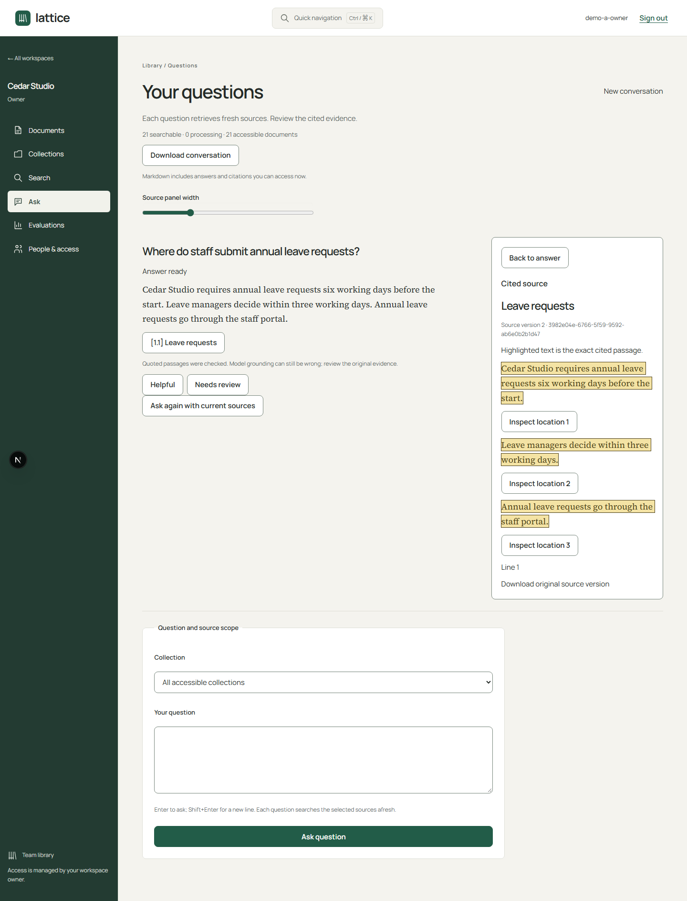
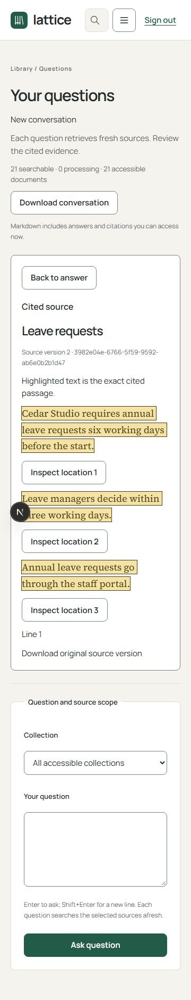
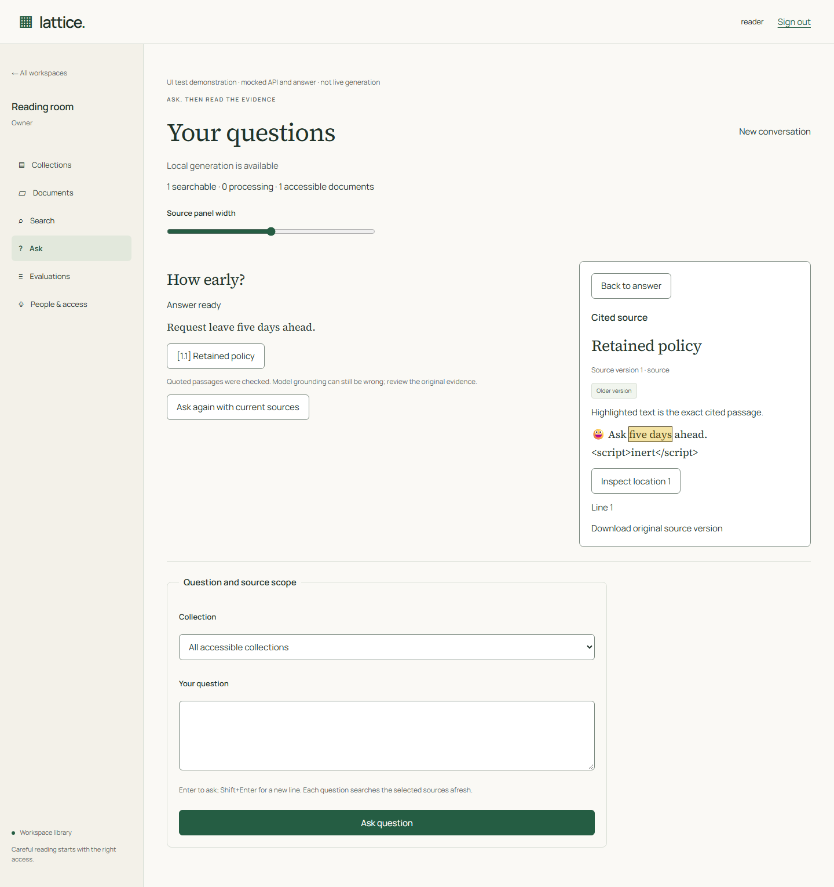
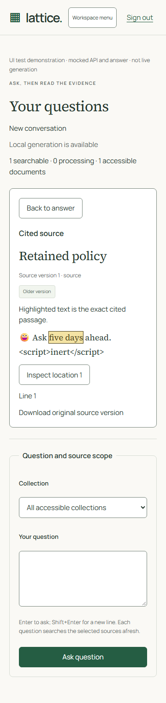
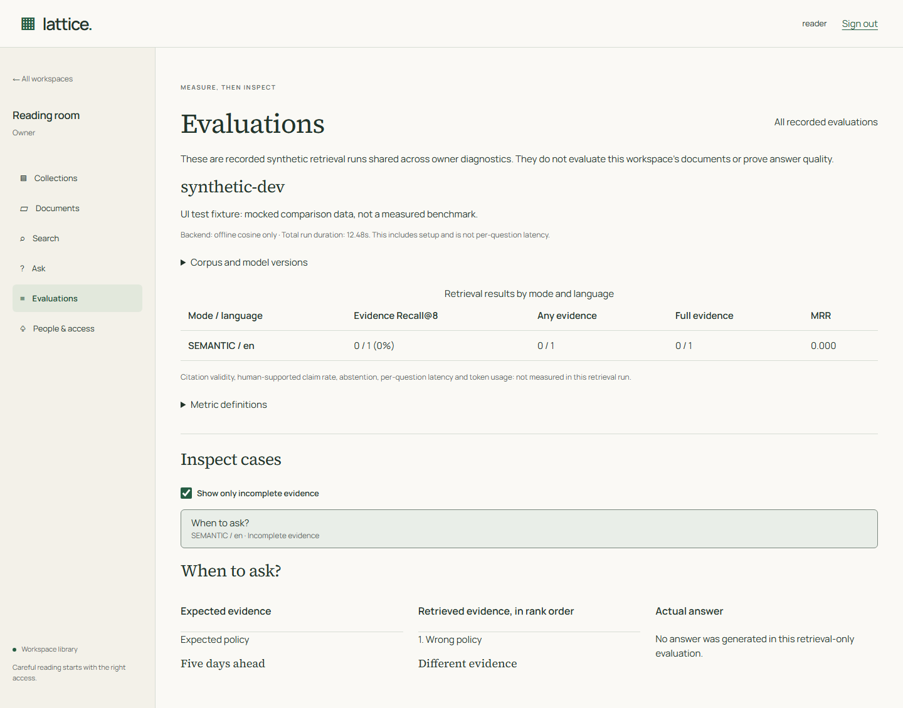
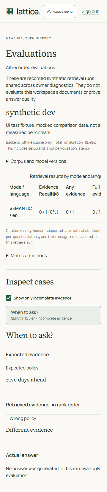

# Lattice demo and handoff

R1–R8 features and the UI refresh are implemented. Docker execution resumed on
10 October 2026. [Actual results](EVAL-RESULTS.md) record real ingestion, live model
answers, restore and fresh-checkout checks, with answer-quality failures and human
review still open. Historical illustrative UI fixtures below remain labelled.
The [refreshed interface guide](UI.md) shows the current design with fictional preview
data. The [acceptance workflow](evaluations/ACCEPTANCE.md) covers implemented database
comparison and actual-answer capture/human-review commands.

## Actual local demonstration — 10 October 2026

The following captures use the real API, Redis workers, parser and pinned E5/Qwen
models on the fictional r8-v1 corpus. The answer is actual `development-03` output;
its exact highlight is not a substituted fixture. Feedback persistence, current-access
Markdown download, 360px overflow and source-focus return passed in the live browser.





[Two-minute walkthrough](assets/acceptance/walkthrough.webm): actual 20-page native
PDF upload/indexing, a previously generated live cited answer, mobile inspection
and deletion of the newly uploaded private probe. Explicit reading pauses are
included; video duration is not a latency measurement. Upload to READY index took
24.139 seconds, including extraction (5.887 seconds) and UI polling. The recording
shows the local development server; it is not a production deployment.

## Review today without Docker

1. Read [the frozen evaluation](evaluations/R8.md): 24 fictional documents, 25 source
   versions, 40 development and 40 held-out cases, actual model/profile and counts.
2. Run its `--validate-only` command. Optionally reproduce offline E5 retrieval with
   prepared model files. The command never modifies application data.
3. Build and run the UI checks on the existing host:

   ```sh
   pnpm build
   pnpm --filter @lattice/web exec playwright test --config playwright.reader.config.ts
   ```

   This starts only a production web server on loopback port 4413 and mocks every
   API request. It demonstrates source highlight/focus, mobile navigation, resizing,
   evaluation inspection and automated accessibility at 360/768/1200/1440px.
   The answer and deliberately incomplete comparison are **UI test data**, not
   outputs from Qwen or the R8 benchmark.

## Preserved UI evidence

Captured on 8 October 2026 from the production build with mocked APIs. Reader
screens include a visible demonstration label; evaluation screenshots identify
their comparison as a test fixture. None establishes live backend behavior.









## Live walkthrough after infrastructure validation

Use a dedicated disposable demo database and storage root containing no real
documents. Seed/reset and controlled interruption recovery now passed against an
isolated real PostgreSQL installation; the acceptance record identifies that scope.

### Prepare the isolated demo

1. Copy your local `.env` to ignored `.env.demo`. Keep the normal `.env` unchanged.
   In `.env.demo`, set `DEMO_MODE=true`, `POSTGRES_DB=lattice_demo`,
   `STORAGE_ROOT=.data/demo-storage`, `PARSER_SPOOL_ROOT=.data/demo-parser`,
   `RAG_MODE=RETRIEVAL_ONLY` and change the database URL's final database name to
   `lattice_demo`. Keep the host address `127.0.0.1:5440`. Supply a strong
   `LATTICE_DEMO_PASSWORD` (8–128 characters); there is no default password. Do not
   commit this file or show its contents. The password is used for all four demo
   accounts and is never printed. Keep optional cloud keys empty.
2. Stop the normal stack to free its loopback ports. Use the distinct Compose
   project `lattice-demo` for every demo command; it gets separate named volumes.
   The overlay binds only the dedicated demo storage/parser directories for
   application content. Compose merges volumes by container target and applies
   the overlay's environment entries; see [Docker's merge rules](https://docs.docker.com/compose/how-tos/multiple-compose-files/merge/).
3. When Docker validation resumes, run from the repository root:

   ```sh
   docker compose --env-file .env.demo -p lattice-demo -f compose.yaml -f compose.demo.yaml up -d --wait db-pgvector redis mailpit
   uv run --project backend --env-file .env.demo python backend/manage.py migrate
   pnpm demo:seed
   docker compose --env-file .env.demo -p lattice-demo -f compose.yaml -f compose.demo.yaml up -d --build
   ```

   Run seed/reset on the **host**, where database identity and storage path checks
   apply. Seed requires an empty application database and empty demo storage on
   first use. A database marker and matching `.lattice-demo.json` bind it to that
   storage root. No provider, email, Redis or parser call is made by seeding.
4. Sign in as `demo-a-owner`, `demo-a-curator`, `demo-a-member` (MEMBER), or
   `demo-b-owner`. Their emails use `@lattice.invalid`. There are two workspaces,
   four collections, 24 documents and 25 source versions. Only the A curator gets
   a restricted Projects grant; Finance is owner-only. Repeated seed is a no-op
   and does not change accounts or passwords. Adding unrelated accounts or
   workspaces makes the guarded reset refuse to proceed.

### Reset only this demo

Finish or cancel extraction, indexing, reindex and answer jobs in the UI. Stop
API, ingestion/answer workers, beat and parser; leave the dedicated database up:

```sh
docker compose --env-file .env.demo -p lattice-demo -f compose.yaml -f compose.demo.yaml stop api ingestion-worker answer-worker beat parser
pnpm demo:reset --confirm lattice_demo
pnpm demo:seed
```

Reset refuses disabled demo mode, another database or storage path, absent or
mismatched markers, links/junctions, unrelated accounts/workspaces, running jobs,
and a nonempty parser spool. It deletes the two marked demo workspaces' data,
their four accounts, demo database sessions, and dedicated source storage including
demo deletion journals. It retains the installation marker. It never drops a
database, flushes Redis, removes models or clears normal application storage.
Do not put real content in this demo: anything added inside its marked workspaces
and storage is disposable. This reset is not a production erasure procedure.

Interrupted source writes leave `SEEDING`; interrupted storage cleanup leaves
`RESETTING`. Fix the underlying problem and repeat the guarded reset before
seeding. A fresh seed uses new resource IDs so old queued messages cannot address
the new demo's documents. Missing/mismatched marker recovery requires operator
investigation; do not forge or copy a marker to authorize deletion.

### Exercise the live application

1. Follow README setup, start Docker, apply migrations, rebuild API/workers/parser,
   and run real tests. Preserve the independent tombstone journal before any restore.
2. Use the seeded accounts in Cedar Studio (workspace A) and Birch Studio
   (workspace B). The frozen `a-member`
   persona uses the application's MEMBER role so it can ask questions. Its collection
   scope matches the frozen labels; Projects and Finance remain restricted.
3. Inspect A's Handbook (workspace-readable), Projects (restricted, curator grant)
   and Finance (restricted, owner-only). B has its separate Handbook. Follow
   [the manifest](../fixtures/evals/r8-v1.json) when assigning documents; matching
   titles such as Leave requests must remain in different workspaces.
4. The 25 [source files](../fixtures/corpus/r8-v1) are imported as originals only;
   extraction jobs are cancelled and available for Retry on each latest version.
   Seed creates no extracted text, OCR references, indexes or generated answers.
   As owner, Retry, extract/review and prepare indexes. Leave v1 is retained and
   unprocessed; to demonstrate indexing followed by Replace, use a separate
   document uploaded first as v1, index it, then replace with v2. Review the
   scanned `drill-v1.pdf` before acceptance; compare actual OCR to its manual reference.
5. Use keyword search in retrieval-only mode. For semantic/hybrid and answers,
   explicitly prepare E5 and Qwen as described in operations, select local mode,
   and reindex the workspace coherently. No cloud key is needed. Answer controls
   must explain unavailable generation while the default retrieval-only mode remains.
6. Ask the leave-notice question and inspect its exact v2 citation. Ask an unsupported
   question and a conflicting-policy question; record actual statuses, evidence and
   token use. Never present an authored expected answer as a model result.
7. As viewer/curator, test denied collections, same-title B documents, forged scope
   and direct source IDs. Revoke access while a turn runs and while reading history.
   Confirm real retrieval, source and stored-answer denial; fixture filtering is insufficient.
8. Replace an active source, inspect a retained citation, cancel/retry reindex, then
   delete a demo document and test history unavailability and physical purge. Exercise
   crash/replay/race and tombstone-aware restore checks before erasure claims.
9. As owner, open Evaluations. R4 is document-group development evidence; R8 is
   frozen exact-span offline evidence. Both are synthetic artifacts shared across
   owner diagnostics, not measurements of this workspace's uploaded documents.

Do not publish screenshots containing real documents, email, storage paths or
credentials. A future live demo/recording must show its actual model/corpus version
and keep unexpected outcomes rather than replacing them with fixture output.

## Completion record still required

Record a fresh checkout/machine setup with tool versions and commands; full PostgreSQL
tests and actual ingestion/browser output; lexical/vector/hybrid frozen results;
human-labelled answer/citation/abstention/conflict counts; migration, revocation,
race and restore outcomes; and a live demo recording. Until then, the project is
an implemented application with limited measured evidence, not acceptance-complete.
