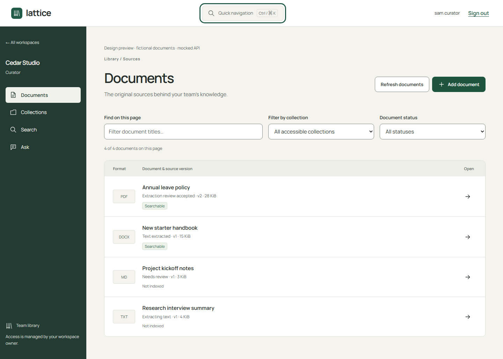
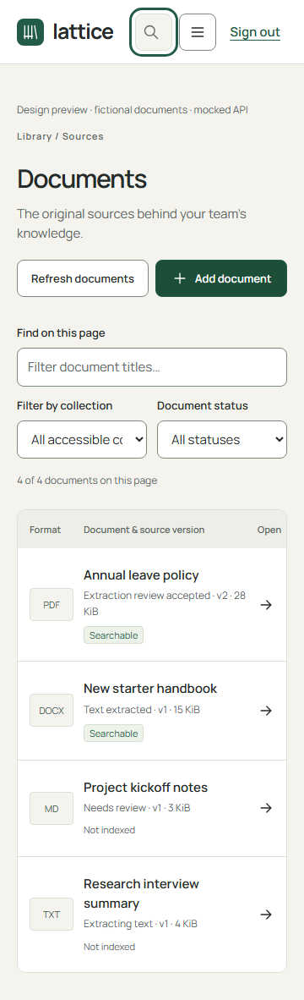
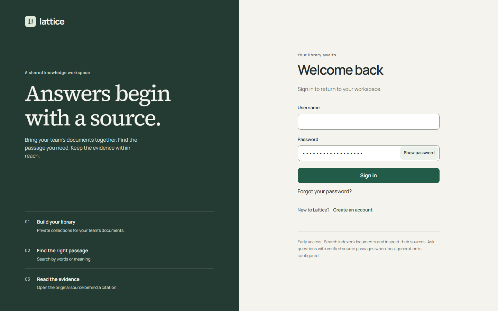

# Interface direction — 9 October 2026

Lattice is a working document library. Documents, source scope and readable evidence
take priority over decorative dashboards. The interface uses paper surfaces, dark
evergreen navigation, a restrained accent and consistent outline icons.

## Typography and layout

- Locally served Manrope 400/600/700 for controls, navigation and application headings.
  Headings have a compact scale, tighter tracking and stronger hierarchy.
- Source Serif 4 for source passages, answers and the sign-in editorial headline.
  Reading text keeps generous line height and bounded line lengths.
- Noto Sans Devanagari 400/600 remains the Nepali fallback. No remote font request.
- Responsive navigation, visible focus rings, 44px controls and reduced-motion support.
  Colour accompanies text labels; searchable status is never communicated by colour alone.

## Interactions

Documents opens with the library list. Add document reveals the upload form. Closing
it preserves the selected file and submission ID; it cannot close during submission.
This preserves retry deduplication after an ambiguous response. Collection selection
queries the server; title and status filters explicitly apply to the current page.
Clear filters restores the page. Existing pagination and background processing refresh
remain available.

Quick navigation opens with its button or Ctrl/Command+K. Search filters destinations,
Tab moves to links, Enter opens one, and Escape closes the native modal and restores
focus. Owner tools appear only in owner navigation; server authorization still governs
every destination. On small screens the menu and navigation buttons retain accessible names.

Search leads with the query and discloses method/scope controls. Ask displays actual
generation availability, collection scope and private conversation history. Retention,
workspace indexing and quota controls use neutral disclosure panels. Warnings keep their
separate meaning. Password visibility is an explicit toggle with a pressed state.

The disclosure approach follows [NN/g guidance](https://www.nngroup.com/articles/progressive-disclosure/).
Type hierarchy uses the principle of a consistent [type scale](https://design-system.service.gov.uk/styles/type-scale/).
The visual identity and fonts are specific to Lattice.

## Verified previews

These screenshots use fictional documents and mocked APIs. They demonstrate design,
not a running ingestion pipeline or a measured answer.

After `pnpm build`, run `pnpm test:ui` without Docker. Ten Chromium journeys cover
sign-in, password visibility, document filtering, disclosure, keyboard navigation,
reader/citation focus and evaluation inspection at 360/768/1200/1440px with axe
WCAG A/AA checks. They are mocked UI checks, not full WCAG certification or API acceptance.
